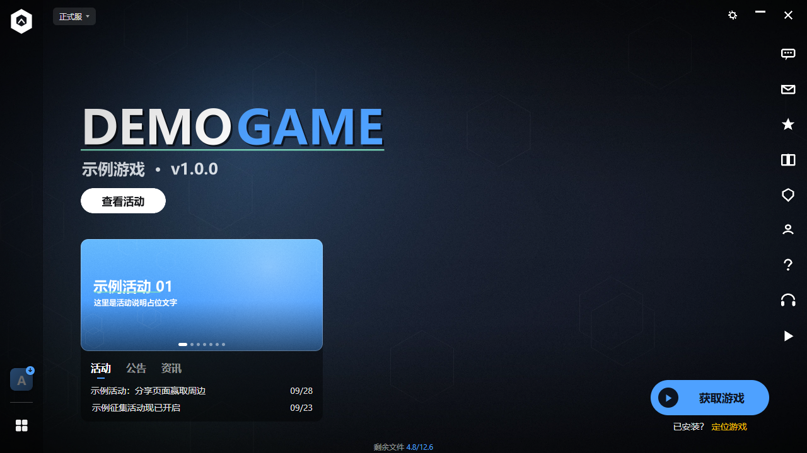
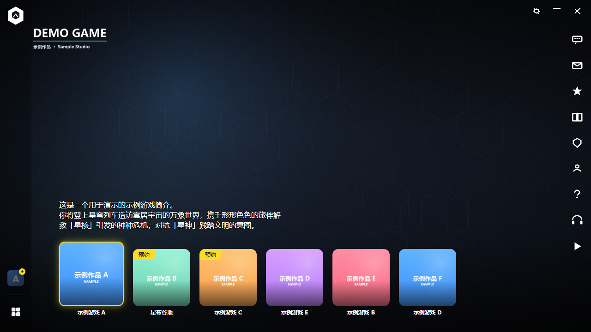

# Launcher UI Shell

一个**纯静态**的游戏启动器界面外壳：`HTML + CSS + 原生 JS`，零构建、零依赖，
直接丢进 **WebView2** 或任何浏览器就能跑。

自带一套**中性占位素材**（全部由脚本生成），克隆下来就能看到完整效果；
把素材换成你自己的图即可成为你自己的启动器。




---

## 它包含什么

### 界面

- **Hub 页** — 游戏选择：大背景 + 落地 logo + 描述 + 卡片网格
- **游戏启动页** — 背景叠层、活动轮播（含圆点与切换）、活动/公告/资讯三个页签、
  版本热点 chip、底部分数进度
- **外围框架** — 顶部拖拽区、左侧 68px 图标栏（游戏列表 + 下载态蒙层 + 红点）、
  右侧社交栏、自绘窗口按钮（设置 / 最小化 / 关闭）
- **设置弹窗** — 720×480，左侧分类 + 右侧表单；
  支持 `switch / check / input / select / seg / slider / button / about` 八种行类型

### 交互与状态

- 页面切换、游戏切换（滑动过渡）、轮播自动播放与暂停
- **下载状态机**：未安装 → 排队 → 下载 → 暂停 → 校验 → 解压 → 安装 → 完成，
  外加**失败重试**、**预下载（停在"待安装"）**、**多任务并发**、**限速**
- **卸载**：右键侧栏图标 → 二次确认
- **设置持久化**：`localStorage`，启动时读回；能本地生效的（动效 / 语言 / 字号）直接应用
- **增量更新**（可选模块，见下）

### 体验细节

- Toast 轻提示（最多 3 条、可带操作按钮）
- 自定义 tooltip（`data-tip` 属性，240ms 延迟，自动避让边界）
- 账号弹窗、背景切换器、区服切换器、Hub 骨架屏、背景视频层
- 键盘可达：`html.kb` 只在按 Tab 时打开焦点轮廓，弹窗用 `trapFocus` 锁焦点
- `prefers-reduced-motion` + 设置里的「减少界面动效」
- 视口小于 1280×720 时整体等比缩放
- 中英文案字典（`config.locales`）

---

## 快速开始

```bash
# 任意静态服务器都行；仓库自带一个（顺便提供 CORS，方便测增量更新）
python tools/sim/serve.py 8899
# 打开 http://127.0.0.1:8899/
```

调试用 URL 参数：

| 参数 | 作用 |
|---|---|
| `?page=hub` | 直接进 Hub |
| `?game=<key>` | 直接进某个游戏的启动页 |
| `?stage=1` | 舞台模式：画布在视口里居中（浏览器 kiosk 预览用） |

### 接进 WebView2

```csharp
webView.CoreWebView2.SetVirtualHostNameToFolderMapping(
    "app.local", @"C:\path\to\src",
    CoreWebView2HostResourceAccessKind.Allow);
webView.CoreWebView2.Navigate("https://app.local/index.html");

webView.CoreWebView2.WebMessageReceived += (s, e) => {
    var msg = JsonDocument.Parse(e.TryGetWebMessageAsString());
    // msg.RootElement.GetProperty("action") / .GetProperty("payload")
};
```

页面发出的消息统一是 `{ action, payload }`，共 27 个 action
（`window.*` / `game.*` / `settings.*` / `app.*` / `shell.*`），
完整清单见 [src/js/bridge.js](src/js/bridge.js) 顶部注释。

**窗口尺寸**：设计基准是客户区 **1280×720**。建议去掉系统标题栏，
让页面自绘的按钮接管窗口控制。

---

## 目录

```
src/
  index.html              唯一入口
  css/
    tokens.css            设计变量（含实测来源注释）
    base.css              重置与排版
    shell.css             背景层 / 左栏 / 右栏 / 顶栏
    pages.css             页面、弹窗、下载态、控件
  js/
    config.js             ← 所有内容与文案都在这里
    bridge.js             宿主通信层（27 个 action）
    ui.js                 通用 UI 原语（toast / tooltip / popup / 骨架 / 焦点 / i18n）
    updater.js            增量更新客户端（内容寻址分块）
    app.js                渲染与状态机
  assets/
    img/                  背景、卡片、chip、二维码
    icons/                应用 logo、游戏图标、社交图标、窗口按钮
tools/
  render_page.py          截图（Playwright）
  render_settings.py      设置页逐分类截图
  compare_render.py       与参考图做像素差
  make_placeholder_assets.py  重新生成中性占位素材
  test_abc.py             功能验收（26 项）
  test_download.py        下载流程验收
  test_update_flow.py     更新流程验收
  test_chip.py            chip 两态验收
  sim/                    增量更新模拟
```

---

## 换成你自己的东西

### 1. 素材

`tools/make_placeholder_assets.py` 生成的是**中性占位**（脚本画出来的，无版权问题）。
换成自己的图按下表对应替换即可：

| 文件 | 用途 | 建议尺寸 | 适配方式 |
|---|---|---|---|
| `img/bg-*.webp` | 启动页底图 | 2560×1440（16:9） | `fill` |
| `img/overlay-launcher-title.webp` | 标题叠层 | 2560×1440 RGBA | 透明叠层 |
| `img/bg-hub*.webp` | Hub 底图 | 2560×1440 | `fill` |
| `icons/hub-land-logo-*.png` | Hub 落地 logo | 420×320 | `contain` |
| `img/hub/card-*.png` | Hub 游戏卡 | 288×288 | `cover` |
| `icons/icon-*.png` | 游戏图标 | 96×96 | `cover` |
| `img/card-banner-*.png` | 活动轮播 | 768×356（2.157:1） | `cover` |
| `img/chip-*.png` | 版本热点 chip | **80px 高，宽 2 倍** | `height:40px; width:auto` |
| `icons/social-*.png` | 社交栏图标 | 72×72 | `contain` |
| `icons/logo-app.svg` | 应用 logo | 44×44 | 内联 SVG |

窗口按钮（`win-*.png`）按**原始像素**显示，所以 2 倍图要在 CSS 里钉尺寸。

**chip 有个坑**：它是**两张图叠着**（常态 + 悬停），靠
`flex-direction:column; height:40px; overflow:hidden` 加
`:hover { translateY(-100%) }` 上滚切换。只放一张的话，悬停会把它自己滚出可视区、
底下空掉 —— 看起来就是"按钮滑上去了"。

### 2. 内容

全部在 [src/js/config.js](src/js/config.js)：应用名、主色、游戏列表、
每个游戏的背景 / 图标 / 简介 / 资讯 / 区服 / 背景列表、设置项分类与行。

改主色只要两个字段：

```js
accent: '#4ea1ff',      // 主色
accentInk: '#0d1420',   // 主色上的文字色
```

---

## 增量更新（可选模块）

`src/js/updater.js` + `tools/sim/` 实现**内容寻址分块的增量更新**：
只下载变化的块，不重下整个包。产物可直接放 Cloudflare R2 / S3 / 任意静态存储。

```bash
python tools/sim/make_fake_apps.py     # 造 v1 / v2 两套假软件包
python tools/sim/pack.py               # 分块 + 生成清单 + 内容寻址仓库
python tools/sim/serve.py 8899         # 起服务（带 CORS，chunk 跨源必需）
python tools/sim/test_updater.py       # 端到端验证
```

实测（v1 → v2，目标版本 10.28 MB）：

```
计划：唯一分块 10.28 MB，可复用 8.81 MB，需下载 1.47 MB（24 块）
实际：下载 1.47 MB / 24 块，失败 0，省下 85.7%
拼装 30 个文件 → 与磁盘 v2 逐个 SHA-256 比对：30/30 完全一致
```

支持**固定分块**与 **CDC（内容定义分块，gear hash）** 两种策略。
一个反直觉的结论：

| 变化类型 | 固定分块 | CDC | 谁省 |
|---|---|---|---|
| 文件开头插入 | 后续全部错位 | **按内容切点，不受影响** | **CDC 明显更省** |
| 中间改一小段 | **只坏 1~2 块** | 块大小不齐，可能更大 | 固定分块更省 |
| 尾部追加 | **只多最后一块** | 边界可能重算 | 固定分块更省 |

所以：**大量"插到中间"的改动选 CDC，否则固定分块更简单也够用。**

启用方式：把 `config.js` 里 `updater.enabled` 改成 `true`，
`latestUrl` 指向你的清单地址。打开后点「获取游戏」就走真实分块下载，
下载 UI（圆环 / 速度 / 暂停 / 重试）照常工作。

详见 [tools/sim/README.md](tools/sim/README.md)。

---

## 工程说明

**并发**：分块下载默认 6 并发，可在 `updater.concurrency` 调整。
限速在客户端这一层做（接界面里的「下载限速」设置）。

**校验分层**：每个分块校验一次 SHA-256，拼装后再做整文件 SHA-256。
两层都要：前者挡传输损坏，后者挡拼装逻辑错误。

**断点续传**：已下好的分块留在 `have` 集合里，重入时自动跳过，
不需要额外的断点文件；真实实现建议把分块落到 `chunks/<hash>` 缓存目录。

**CORS**：chunk 放 CDN 就必须发 `Access-Control-Allow-Origin`，
否则 `fetch` 直接失败。`tools/sim/serve.py` 是带 CORS 的最小实现。

**字体**：用系统字体栈 `"Microsoft YaHei UI", "Segoe UI", Arial, sans-serif`，不加载中文字体。

---

## 说明

- 素材是**脚本生成的占位图**，不含任何第三方美术资源。
  `.gitignore` 排除了本地采集用的 `reference/` 与调试 profile，你不需要它们。
- 界面的尺寸、间距、配色等数值，是在研究一款商业游戏启动器的实际渲染结果
  （逐元素量测 + 像素比对）后确定的。这类**功能性、布局性数据**用于学习与自建启动器；
  本仓库不附带该产品的任何美术资源或代码。
- 发布你自己的启动器时，**请务必使用自己的素材与品牌**，
  并遵守所接入游戏 / 平台的相关条款。

## License

MIT，见 [LICENSE](LICENSE)。`src/assets/` 下的素材由脚本生成，同样可自由使用。
